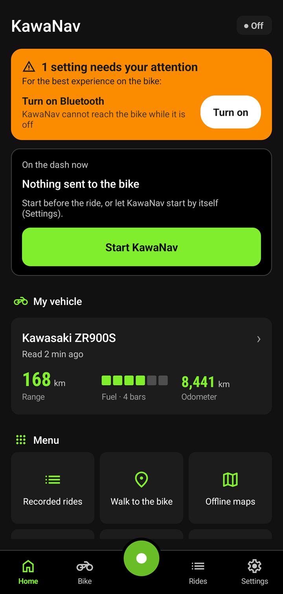
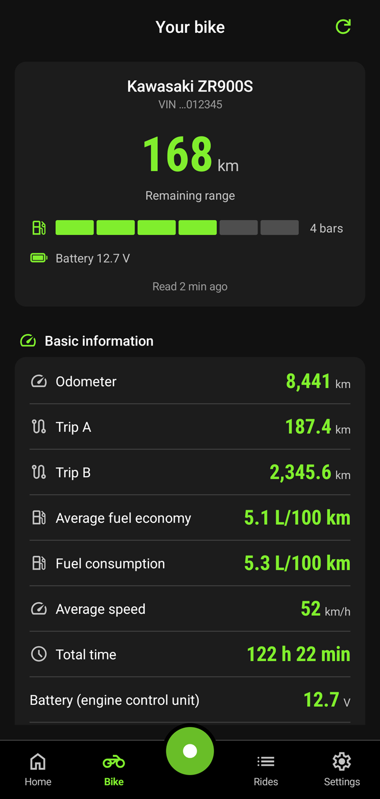
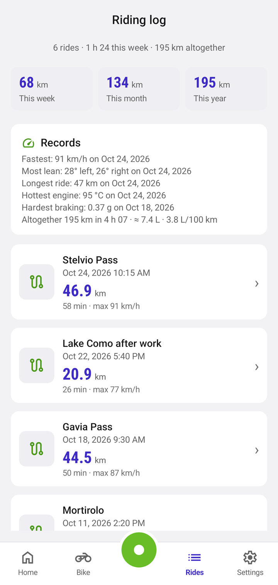
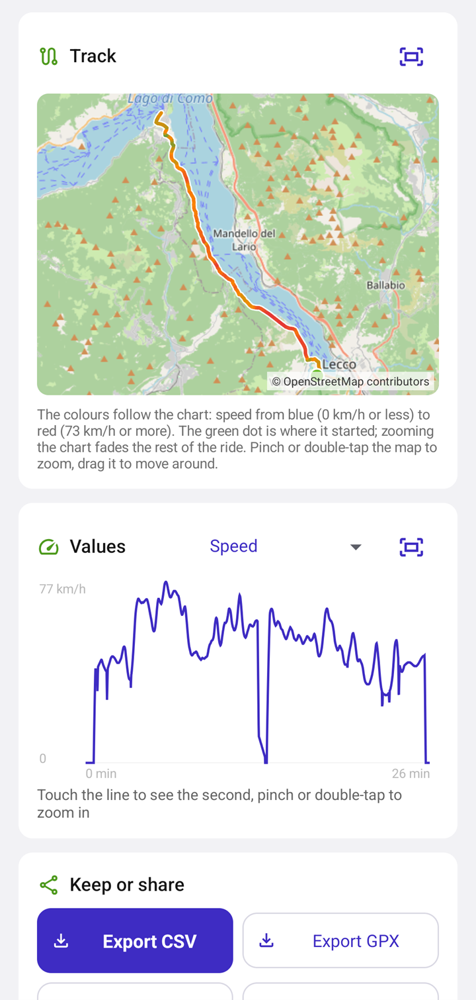
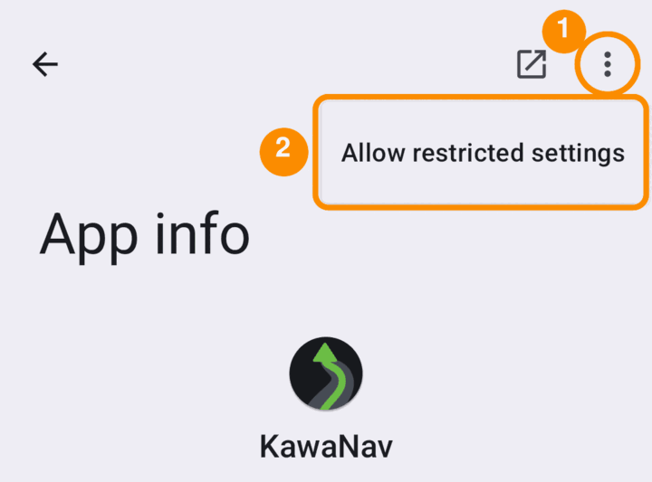

# 🏍️ KawaNav

Android app that shows **Google Maps turn-by-turn directions** or the **upcoming curves of the road
you are on** on the TFT dash of a Kawasaki motorcycle, and that reads the bike's own data (odometer,
fuel, temperatures, settings), **records your rides** with a track, charts and an export, and keeps a
diary of refuels, battery readings and maintenance.
It talks to the dash (Kawasaki calls it the "meter", hence the name in the code and protocol notes) the
same way Kawasaki's Rideology app does (Bluetooth LE, see [docs/PROTOCOL.md](docs/PROTOCOL.md)) and
replaces Rideology's link to the bike.

  
  
  
  

Home and the bike in dark mode, the riding log and a ride in light mode. Android emulator with
sample data: made-up rides on real Alpine roads.

Independent project, not affiliated with or endorsed by Kawasaki or Google. Tested on a Kawasaki
Z900 (2026, "Kawasaki-ZR900S") with a Pixel 9. Free software under the
[GNU GPL v3](LICENSE).

> ⚠️ **Safety:** KawaNav is a riding aid, not a safety system. Directions and curves can be late,
> missing or wrong. Always ride by what you see on the road and keep your eyes on it. Use at your
> own risk; there is no warranty (see [License](#-license)).

**Contents:** [Features](#-features) · [Compatibility](#-compatibility) · [Install](#-install) ·
[Using KawaNav](#-using-kawanav) · [Bike data](#-bike-data) · [Recording rides](#-recording-rides) ·
[Diary](#-diary) ·
[Settings on the bike](#-settings-on-the-bike) ·
[Speed cameras](#-speed-cameras) ·
[Known limitations](#-known-limitations) · [License](#-license)

## ✨ Features

- 🧭 **Google Maps directions on the dash**: KawaNav reads Google Maps' navigation notification and sends
  arrow + distance to the dash. The arrow is recognised from Maps' own icon (language independent);
  the text decides roundabout exit numbers and highway ramps/exits — and, when the text names a side
  of its own ("Take the ramp on the left"), the side it names, while a text that names only the kind
  of maneuver ("Take the exit") leaves Maps' arrow alone instead of overriding its side. Waze is not supported: its
  notification only says it is running, with no turn in it — checked on a phone, see
  [docs/WAZE.md](docs/WAZE.md).
- 🌀 **Free ride: upcoming curves**: without navigation, the dash shows the next curve of the road you
  are on (slight / normal / sharp / hairpin) with its distance, roundabouts with the exit that
  continues the road, and on straights the straight arrow with the distance to the next curve.
  Works from offline OpenStreetMap data, no mobile data needed while riding.
- 🗣️ **Spoken curve warnings** (optional, off by default): "Sharp bend left", "Hairpin right" in your
  helmet a few seconds before the bend, for the kinds of bend you choose, and "Bend left, slow down"
  when you come at a bend too fast for your pace, a pace you pick or the one your recorded rides
  show. With or without navigation.
- 🔋 **Phone battery and headset on the dash**: the dash's phone battery icon shows the phone's charge
  in 4 bars, like with Rideology, and that it is charging; the headset icon shows while your helmet
  intercom is connected.
- 🔑 **Starts by itself** when the bike is switched on (or the helmet intercom connects), also with the
  phone locked in a pocket, and stops 5 minutes after the bike is switched off (once a ride being
  recorded has ended, see [Recording rides](#recording-rides)).
- 📊 **The bike's own data**: odometer, trip A/B, fuel and range, battery voltage, outside and engine
  temperatures, maintenance reminders, VIN, and live values while riding (speed, engine speed, gear,
  throttle, lean angle). The last values are kept, so they are there with the ignition off, and the
  phone remembers where the bike was parked ("Walk to the bike").
- 🗺️ **Ride recording**: records once a second — the bike's values and the phone's GPS track — and keeps
  the rides with a summary, a track on a map you can zoom coloured by the value the chart shows, charts you can zoom for any value (touch to see where you were)
  and export as Rideology's CSV or as GPX. Since 0.8 the ride also holds what the suspension unit and the
  body were doing (travel, accelerations, rotation rates, filtered wheel speeds) and the rest of the live
  frame (torque, brake pressures, ABS state, damping, cruise control). A ride survives the app being
  killed, and so does its sample file: a compression interrupted while the app is killed leaves the
  plain file in place instead of a half-written one, and the ride is compressed again next time.
- 🔔 **Call and mail icons on the dash**: the dash shows an icon while a call comes in or a mail or
  message arrives, also from WhatsApp, Telegram, Signal, Messenger, Threema and Outlook (their calls
  light the call icon). Only the fact there is one is sent: no numbers, no names, nothing stored. An icon
  that appeared while KawaNav was not connected is sent as soon as it connects again, so a call that
  came in with the bike off is not lost.
- 🕐 **Dash clock from the phone**: optional, once per connection, like Rideology.
- 🔧 **Settings on the bike**: reads the ride settings (riding mode, power, KTRC, quickshifter, and the
  suspension settings on bikes that have them), and writes riding mode/power/KTRC/KQS and the dash
  shift lamp after a confirmation (both tried on a Z900). The riding-mode list follows the bike: four
  modes, or seven (Rider 2-4) on a bike that announces them.
- 🌍 **Offline maps**: download regions (country, state, district) from Geofabrik, see their data date,
  update and delete them one by one.
- 🚨 **Speed camera warnings** (optional, off by default): taken from the same offline map data, shown on
  the phone and with the distance on the dash. Announcing cameras is illegal in some countries — read
  [Speed cameras](#-speed-cameras) before switching it on.
- ⛽ **Refuel diary**: a fill is noticed while you stand at the pump (the gauge and the range jumping up)
  and kept with the fuel used between fills; correct the litres or add one by hand.
- 🔋 **12 V battery over time**: the voltage at rest, read once per stop, charted — with a warning when it
  has been sliding for a while. Tapping the battery figure on the bike screen opens it.
- 🔧 **Maintenance log**: what you had done, when and at what odometer, next to the reminders the dash
  keeps.
- 🏆 **Records**: fastest ride, most lean each way, longest ride and the distance per year in the riding
  log; a ride ends with a summary notification (distance, time, fuel, lean).

## 📱 Compatibility

### 📋 Requirements

- Android 13 or newer, with Bluetooth LE and GPS
- Google Maps (for directions)
- The bike paired with the phone once (Android-level bonding): with KawaNav's "Pair your bike" or in
  Rideology (both tested). If Rideology is installed, it must be closed (**force-stopped**) while
  KawaNav is used: the bike talks to one app at a time.

### 🏍️ Supported motorcycles

Any Kawasaki whose dash shows Rideology's turn-by-turn navigation (BLE5 meter). From Kawasaki's
model pages (details and sources in [docs/MODELS.md](docs/MODELS.md)):

| Status | Models |
|---|---|
| ✅ Tested | Z900 2026 |
| 👍 Turn-by-turn confirmed by Kawasaki | Z900 / Z900 SE (2025+), Z1100 / Z1100 SE (2026+), Ninja ZX-10R / ZX-10RR (2026+) |
| ❓ Unclear | Ninja 1100SX, Versys 1100 (2025+), Z650 S (2026), Ninja 650 / Ninja H2 (2027) |
| ❌ Not supported | Z900RS 2026 (analog dials), Rideology bikes 2019–2024 (older dashes without turn-by-turn) |

KawaNav does not check the model. After connecting it asks the dash what it can show; a dash that
reports no turn-by-turn support gets a warning in the app (KawaNav keeps sending, the arrows will
probably not appear).

### 🌐 Google Maps languages

Google Maps writes its directions in the phone's language (or Maps' own language: Android settings →
Apps → Maps → Language). The arrow works in every language because it comes from Maps' icon; the
language matters for roundabout exit numbers, highway ramps/exits/merges and as fallback when an
icon is not recognised.

| Language | Status |
|---|---|
| German, English | ✅ Verified on real Maps notifications |
| French, Spanish, Italian, Dutch, Portuguese, Polish, Czech, Swedish, Danish, Norwegian, Finnish, Greek, Russian | 🟡 Supported, wording based on Google's usual phrasing, not yet checked on real notifications |

Distances are read in m/km, mi/ft/yd and Cyrillic/Greek units (м/км, μ/χλμ). The word lists are in
`MapsParser.java`.

The app's own screen is in English.

## 📦 Install

1. Download the APK from the [Releases](../../releases) page and open it on the phone (allow
   installing apps from your browser or file manager when Android asks). Later versions: KawaNav
   offers them itself when you open it (it looks for one at most every 6 hours).
2. Open KawaNav. On the first start it walks you through pairing, permissions and notification
   access, explaining each step. Anything missing later shows up in an **orange banner** at the top
   of Home, each item with a button that fixes it.

🔒 **Notification access greyed out?** Android 13 and newer protect notification access ("Restricted
setting") for apps installed from a downloaded APK instead of an app store. Unlock it once:

1. In the notification access screen, tap KawaNav and its greyed-out switch once. Android refuses
   ("App was denied access"), but only after this attempt does the menu entry in step 2 appear.
2. Settings → Apps → KawaNav → **⋮** (top right) → **Allow restricted settings**, and confirm.
3. Back in KawaNav, tap "Open" for Google Maps directions and turn the switch on.

KawaNav shows these steps itself ("Switch greyed out?") when it notices the situation.

## 🏁 Using KawaNav

### 📱 The app

Laid out like Rideology: a bar at the bottom with **Home**, **Bike**, the round **record button**,
**Rides** and **Settings**. It follows the phone's dark or light mode (black with lime green, or white
with violet).

- **Home**: the link to the bike and what the dash shows right now, the ride being recorded, the bike's
  last values ("My vehicle") and a menu of shortcuts. The orange banner shows up here too.
- **Bike**: everything the bike reported, see [Bike data](#-bike-data).
- **Record button**: green starts recording a ride, red while recording, orange while paused. Tapped
  while a ride runs, it offers to pause, continue or stop.
- **Rides**: the riding log, see [Recording rides](#-recording-rides).
- **Settings**: everything below that can be switched; the shortcuts on Home jump to their group.

Back from Bike, Rides or Settings goes to Home.

### 📟 What the dash shows

Once a second KawaNav decides what goes on the dash:

1. **Google Maps is navigating** (and "Google Maps directions" is on): Maps' maneuver and distance.
   With "Curve warnings during navigation" on, curves before the next maneuver are shown from 300 m.
2. **Otherwise, "Show upcoming curves" is on**: the next curve or roundabout within the look-ahead;
   beyond it, the straight arrow with the distance to the next curve (searched up to 3 km).
3. Otherwise nothing.

Turning KawaNav off (or "Stop") clears the dash first — the arrow, the distance and the phone battery
icon — and only then lets the link go, instead of leaving the last arrow on the meter. A live frame the
meter sent incomplete (a Bluetooth packet cut short) is dropped whole rather than decoded: half a frame
used to read as a lean of −100° or a gear of 15 for one second.

### 🔧 Settings

In the **Settings** tab:

| Setting | Default | Effect |
|---|---|---|
| [Google Maps directions](#google-maps-directions) | On | Off: Maps is ignored, free ride also runs during navigation |
| [Show upcoming curves](#show-upcoming-curves) | On | Free ride when Maps is not navigating |
| [Curve warnings during navigation](#curve-warnings-during-navigation) | Off | Off / sharp only / all curves between Maps directions |
| [Spoken curve warnings](#spoken-curve-warnings) | Off | Off / hairpins only / sharp and hairpins / all curves, said in the helmet |
| [Also when too fast](#too-fast-for-your-pace) | Off | Off / Relaxed / Normal / Sporty / Fast / From my rides: any bend, with "slow down" |
| [Speak only through a headset](#spoken-curve-warnings) | On | No spoken warnings while no headset is connected |
| [Beeps instead of words](#spoken-curve-warnings) | Off | The warnings as beeps in the ear of the bend's side |
| Which curves count | Normal | Only tight ones / Normal / Also gentle ones / All over 15° (explained in the app) |
| [Look ahead](#look-ahead) | 1000 m | 500 / 1000 / 1500 / 2000 m |
| [Phone battery](#phone-battery) | On | Phone battery icon on the dash |
| [Battery warnings](#battery-warnings) | On | Warnings when the bike's 12 V battery reads low |
| [Clutch warning](#clutch-warning) | On | A warning after a recorded ride whose clutch slipped under load |
| [Fuel economy](#fuel-economy) | L/100 km | km/L / L/100 km / MPG US / MPG UK |
| [Start recording by itself](#recording-rides) | Off | Begins a ride when the bike is connected and moving |
| [End a ride](#recording-rides) | At once | At once / After 5 min / After 15 min: when a ride ends after the bike is switched off |
| Set the dash clock from the phone | Off | Sets the dash clock once per connection |
| Call icon on the dash | Off | Shows an icon while a call comes in, also a WhatsApp/Telegram/Signal call (needs notification access) |
| Mail and message icon on the dash | Off | Same for mail and messages (Gmail, Outlook, Messages, WhatsApp, Telegram, Signal, …) |
| [Speed camera warnings](#-speed-cameras) | Off | Cameras on the phone and on the dash |
| [Say speed cameras](#-speed-cameras) | Off | Each camera also said in the helmet (or beeped) |
| [Distances in feet](#distances-in-feet) | Off | Imperial distances |
| [Left-hand traffic](#left-hand-traffic) | Off | For countries driving on the left (UK, Ireland, …) |

#### Google Maps directions

While Google Maps is navigating, the dash shows Maps' next maneuver and its distance, and free ride
pauses. Switched off, KawaNav ignores Maps completely: free ride keeps showing curves during
navigation, and notification access is no longer needed.

#### Show upcoming curves

Free ride: when Maps is not navigating, KawaNav follows the road you are on (at junctions: the road
with the same name or number, else the straightest one) and shows what comes next:

- the next curve with its distance to where the bend starts; once you are in a bend, the one after it;
- a roundabout as roundabout symbol with the exit that continues your road;
- on a straight, the straight arrow with the distance to the next curve (searched up to 3 km ahead,
  or to the end of the downloaded roads).

Needs [offline maps](#-offline-maps) for the area.

#### Look ahead

How far ahead a bend or roundabout appears as its own arrow. Further away, the dash shows the
straight arrow with the distance to it. A longer look-ahead announces bends earlier; a shorter one
keeps the straight arrow longer on roads with few bends. 1000 m is about 36 s at 100 km/h.

#### Curve warnings during navigation

Between Google Maps' directions, bends on the way to the next maneuver can interrupt Maps' arrow. A
bend is shown from 300 m before it, and only if it starts at least 50 m before Maps' next maneuver;
afterwards the dash goes back to Maps' arrow. "Sharp only" shows sharp bends and hairpins, "All"
every bend that counts under "Which curves count". Off by default: the dash then shows only Google
Maps. Needs downloaded roads like free ride.

#### Spoken curve warnings

KawaNav says the kind of bend and its direction — "Hairpin right", "Sharp bend left", "Bend left",
"Slight bend right", the kinds of the dash's arrow — about 6 seconds before the bend starts at your
speed: 50 m before it when slow, up to 300 m when fast. Pick which bends are said: hairpins only,
sharp bends and hairpins, or all curves that count under "Which curves count". Off by default.

- Each bend is said once, however often the curves are found again on the way to it, and nothing is
  said below 10 km/h. A bend that comes less than 4 s after the last warning waits for its turn.
- Your speed, for when a warning comes and for "too fast", is the bike's own while it is connected
  (it has no delay; the GPS speed comes up to a second late), and the GPS speed without the bike.
- A bend that starts within 80 m after the end of the one said is named with it: "Hairpin left, then
  sharp bend right". It is not said again on its own, unless you come at it too fast (see below).
  Only a bend of the kinds you picked is named this way (any kind when the kinds are off).
- It works with or without navigation, whatever the dash shows. During navigation a bend within 50 m
  of Maps' next maneuver is left to Maps' own voice, and nothing is said while Maps names no distance.
- The voice is the phone's text-to-speech, in English (the phone's own voice reads the words if no
  English voice is installed). It plays as navigation guidance, like Google Maps' voice: it goes to
  the helmet intercom and turns music down while it speaks.
- **Speak only through a headset** (on by default) keeps it quiet while no Bluetooth or wired headset
  is connected, so the phone does not speak out of a pocket.
- **Beeps instead of words** (off by default): the bend beeps in the ear of its side (the other ear
  hears it faintly, so a mono intercom still plays it). One beep for a slight or normal bend, two for
  a sharp one, three for a hairpin; higher and quicker when you are too fast for it. A bend named with
  it follows after a short pause, in its own ear. A speed camera, if it is said, sounds like a siren
  instead ([Say speed cameras](#-speed-cameras)). A phone without text-to-speech beeps anyway.
- **Hear a curve warning** → Play plays the warning for a sharp bend to the left right away ("Sharp
  bend left", or its two beeps), to set the volume in the helmet.

Needs downloaded roads like free ride.

##### Too fast for your pace

**Also when too fast** (off by default) says a bend of any kind, with "slow down" ("Bend left, slow
down"), when you come at it faster than your pace takes it. It works also with "Spoken curve
warnings" off, for the bends that count under "Which curves count". The pace is how far you lean
through a bend; from the bend's radius in the map data it gives the speed you would take it at
(v² = g · r · tan lean):

| Pace | Lean | Radius 30 m | 60 m | 100 m | 200 m |
|---|---|---|---|---|---|
| Relaxed | 20° | 37 km/h | 53 km/h | 68 km/h | 96 km/h |
| Normal | 28° | 45 km/h | 64 km/h | 82 km/h | 116 km/h |
| Sporty | 35° | 52 km/h | 73 km/h | 94 km/h | 133 km/h |
| Fast | 42° | 59 km/h | 83 km/h | 107 km/h | 151 km/h |

**From my rides** leans as you do: the lean you usually reach in a bend in your recorded rides.

- Every ride counts its bends: seconds from 30 km/h leant the same way by more than 10°, each bend
  counted with the most lean it reached, if that is at least 15° (sweeps where nobody leans are
  left out) and at most 60° (no lean anyone rides).
- Your usual lean is the middle one of the bends in your last 20 rides that have any: half of them
  taken with less lean, half with more. It is used up to 45°.
- It needs 30 bends. Until then it leans as Normal, and the setting says how many bends it has so far.
- It is worked out again each time KawaNav starts, so a ride finished today counts from the next start.
  Rides recorded before this version count once they are summarised again, which happens the first
  time this is worked out, or when they are opened.
- The lean comes from the bike, so only rides recorded with the bike connected have bends. It is the
  bike's own reading as recorded (its scaling is among the [known limitations](#-known-limitations)).

Then:

- Too fast means more than 10% over that speed.
- It is said once gentle braking would only just be enough: 2.5 s to hear it and react, then about
  0.3 g down to the pace's speed, at most 500 m before the bend. If you are already slowing down
  enough, the distance you need shrinks faster than the distance left, and nothing is said.
- A bend of a kind you chose under "Spoken curve warnings" gets "slow down" added when you are too
  fast for it at the moment it is said.
- The radius from the map is rough, and a wide line makes a bend wider than the road: the speeds err
  on the careful side.

#### Fuel economy

The average and instant fuel economy the dash reports come in km/L, whatever the dash's own display
is set to. KawaNav shows them in the unit picked here — km/L, L/100 km, MPG US or MPG UK, the same
conversions Rideology uses — with the unit spelled out ("5.2 L/100 km"). Rides and refuels keep
L/100 km.

#### Battery warnings

KawaNav warns when the bike's 12 V battery reads low with the engine off, or is not being charged
with the engine running. A warning needs both readings the bike gives (the ECU's and the dash's) below
the threshold, and the meter's next answer 20 s later must say the same: the fuel pump priming before
a start, or the voltage just after one, is not a battery problem. Switched off, battery warnings are
not shown; tyre and ABS warnings stay.

#### Clutch warning

While the clutch holds, the engine speed per km/h of the rear wheel is fixed in each gear. Every
recorded ride with bike data compares its seconds at half throttle or more, in 3rd gear and up, with
the same gear at light throttle on that ride: a slipping clutch lets the engine rev higher than the gear
and the speed give. The ride shows it under Engine ("Clutch under load"). When the engine ran more than
3 % high in two hard accelerations or more, a notification says the clutch may be slipping and opens
the ride. One acceleration alone is not enough: a single odd second is not a worn clutch. On the Z900
the engine reads 1–4 % *below* the light-throttle value at full throttle, so a healthy clutch stays well
clear of it. Shifts, quick-shifter cuts and 1st/2nd gear are left out. Switched off, the ride still
shows the check, only the notification is not sent.

#### Phone battery

While connected, KawaNav sends the phone's battery level to the dash every 5 s, as Rideology does.
The dash shows 4 steps (Rideology's thresholds): up to 10 %, up to 30 %, up to 70 %, above 70 %.
While the phone is on a charger, the icon's charging version is sent (same bars). A reading Android
cannot give, or a drop that is impossible in five seconds, keeps the last level shown. The level comes
from Android's sticky battery broadcast, with the battery service as a fallback; until there is a
plausible reading no icon frame is sent at all, rather than an empty battery (the dash draws "not
available" with its warning icon too). So the dash does not flash its low-battery icon (issue #7).
Switched off, the icon is removed. Not yet tried on the bike.

#### Headset icon

The dash shows its headset icon while the helmet picked under Settings → "Start automatically" → "When
my helmet connects" is connected to the phone (as headset or for audio). With "Off" there, the icon
stays off. Not yet tried on the bike.

#### Distances in feet

Sends distances to the dash in feet instead of metres (not yet tried on the bike).

#### Left-hand traffic

Only matters when KawaNav reads a Maps instruction from its text instead of its icon (rare): a
roundabout is then shown clockwise, a roundabout exit without a number ("turn right at the
roundabout") counts from the other side, and a U-turn without a direction turns right. Free ride
reads the direction of a roundabout from the road itself and needs no setting.

A roundabout whose arrow Maps drew *and* whose number the text names ("at the roundabout, take the
4th exit") keeps the direction of Maps' arrow and takes only the number from the text; the setting is
not consulted there, because the arrow already shows which way around the roundabout goes.

#### Export the log

Settings → About → **Export the log** copies KawaNav's log of the last runs to `Download/KawaNav`, to
attach to a problem report (e.g. a GitHub issue). It records what KawaNav did and sent to the dash,
also on a ride: every change of the arrow and the status icons, with the values behind them. It also
holds Google Maps' directions with street names, the bike's Bluetooth address and the helmet's name,
so read it before you share it. The notification capture stays in the debug build's own export.

### 📊 Bike data

Home shows the bike's last values under "My vehicle" (range, fuel bars, odometer); tapping them, or the
**Bike** tab, opens the bike's own screen. It starts with the remaining range in big figures, the fuel
gauge and the battery voltage, then groups everything the dash reported when it was last connected:

- **Basic information**: odometer, trip A/B, average fuel economy and consumption, average speed, total
  engine hours, outside temperature, the largest lean of the trip each way, the fuel burned in total, both
  12 V batteries (engine control unit and dash) and the distance in total. Values the bike does not have
  (it says so in the frame it sends) are left out rather than shown as zero, and the all-ones values it
  fills in when it has nothing to report are dropped rather than shown as numbers.
- **Engine**: while the bike is connected and sending, the live values (speed, engine speed, gear,
  throttle, lean angle, acceleration), the front brake pressure, the traction control and ABS state, the
  cruise control, the torque the throttle asks for and the engine gives, the filtered wheel speeds and the
  suspension unit's traction control and quick shifter state, then the temperatures and tyre pressures;
  they are gone a few seconds after the bike stops sending.
- **Suspension** (bikes with the electronic suspension): travel, the three rotation rates and the body's
  acceleration, and where the damping stands.
- **Maintenance**: the reminders the meter keeps (Kawasaki service, the rider's own, oil change) with
  their date and distance.
- **Dash**: the clock the dash has (and the shift lamp setting), as last read.
- **Parked**: after the link is lost, the phone's position at that moment, with a "Walk to the bike"
  button that opens Maps in walking mode. It appears only if the phone had a recent position (curves or
  a recorded ride were using GPS).

The VIN is shown masked under the bike's name; tap it to show all of it. The button at the top right
asks the bike for its values again.

Values are shown with the names Rideology uses; where the name could not be verified against a real
bike yet, the number the bike sent is printed in brackets next to it.

### ⛽ Diary

Under the bike's values, three cards keep what the dash cannot: **Refuels** (a fill is noticed while the
bike stands at the pump — the gauge and the range jumping up — with the litres estimated from the tank
size you set and the fuel used between fills; correct anything by tapping it, add a fill by hand, or
long-press to delete), **12 V battery** (tapping the battery figure on the bike screen opens the
readings taken at rest with the engine off, charted, with a warning once they have slid for a while) and
**Maintenance** (what you had done, when and at what odometer, next to the reminders the dash keeps).
They are kept on the phone and included in Android's backup.

### 🗺️ Recording rides

The round button in the middle of the bottom bar (or turning "Start recording by itself" on) records one
line per second: the bike's values that second and the phone's position. Tapping it again pauses,
continues or stops the ride (Home shows the same buttons while a ride runs); a ride that was running when the app was killed is continued after a restart, and one that was
left behind is marked "recovered" and its summary rebuilt from the file. One whose track cannot be read
back at all is marked "track lost" instead and keeps the numbers of its last summary, so it does not read
like a ride that recorded nothing. In the list the ride being recorded is marked "· recording now" and
cannot be deleted until it is stopped: deleting it would unlink the file the recorder is writing into,
and the ride would come back as a finished ride with no track.

Switching the bike off ends the ride. The link to the bike goes, the ride pauses, and once the bike has
been gone 20 seconds it ends, with its summary in a notification. **End a ride** in Settings can wait
5 or 15 minutes instead: switched on again before then, the bike continues the same ride, so a fuel stop
does not split it. KawaNav tells a switched-off bike from one that drops out of reach by the speed it
had when the link went: a link lost while moving (5 km/h or more) is waited for at least 5 minutes
whatever the setting. A ride you paused yourself is left alone until KawaNav itself stops. All this
holds however KawaNav was started; after an autostart, KawaNav stops once the ride has ended and the
bike has been gone 5 minutes.

While a ride runs, Home shows its distance, its time and, when the phone has no fix, "no GPS track" —
the case of a background autostart in an area where KawaNav could not ask for GPS yet. It asks again as
soon as the app is opened or the ride is continued, and the track then starts from that point.

The **Rides** tab ("Riding log") lists them with totals for this week, this month and this year. The
**Records** card keeps the best of the log — fastest ride, most lean each way, longest ride, hottest engine,
hardest braking, most suspension travel — and the totals add up the fuel used, the consumption (over the
rides that know their fuel) and the time the electronics spent working (traction control, ABS, front wheel
up). A ride saved by an older version has
its numbers worked out when the list is shown, a few at a time. A ride
has:

- a summary: six tiles (time, average, top speed, max lean, highest engine speed, fuel used) and the
  consumption in L/100 km, then folding sections — engine, chassis and suspension, brakes and
  electronics, temperatures, data quality — each with the lowest, average and highest of every value
  that ride recorded (the body's accelerations, the lean either side, the wheel and GPS speeds and the
  instant fuel economy among them; the rotation rates and the rear wheel slip from lowest to highest, as
  their average says nothing), how long traction control, ABS, cruise control and the front wheel coming
  up were at work, the time in each gear, the gear changes with those the quick shifter made, and
  whether the clutch held under load ([Clutch warning](#clutch-warning)). The
  fuel used comes from the bike's fuel counter; a bike that sends none (the Z900) gets an estimate from
  the instant fuel economy, marked "≈": each second burns the distance it covered over its km/L, and a
  second without an economy (engine braking, standing still) burns nothing, so idling is left out. The
  instant fuel economy's average is likewise the distance over the litres, not the average of its
  seconds, which would count a second at 5 km/h like one at 120 and read a third or more too high;
- the track, with a dot where the ride started, over an OpenStreetMap map, coloured by the value picked
  for the chart below — blue where it was lowest, then green, orange, red where it was highest (the
  speed until another value is picked); the note under the map gives the values the colours stand for.
  Pinch or double-tap to zoom, drag to move around, and the corner button shows the whole ride again. The map
  is fetched for the area you look at and kept on the phone for a while; without a network the track is
  drawn on its own. It can be turned off in Settings → "Map under the track";
- charts for any value the ride recorded — speed (from the bike and from the GPS), engine speed, gear,
  throttle, lean angle, the roll and yaw rates, temperatures, tyres, battery, fuel use, brake pressure and
  the raw brake values, suspension travel and its speed, the body's accelerations, the filtered wheel
  speeds, the rear wheel's slip against the front, the wheelie angle and more. The **torque** is one chart
  with three lines on one scale — what the throttle asks for, what the engine control asks for, what the
  engine gives — so the moments the electronics take torque away show as the lines parting. Picking a
  value and touching the line marks that second on the track and names the value under the chart.
  Pinch the chart (or double-tap it) to zoom in on a stretch of the ride, move along it with two fingers,
  and the corner button shows the whole ride again; zoomed in, the scale follows what is shown and the
  rest of the track on the map is faded, so the stretch is easy to find. A
  value only shows up when the bike sends it: a Z900, for one, sends no torque, no suspension speeds and
  no raw brake values;
- rename (the pencil at the top), delete, and export: **CSV** with Rideology's column layout (so the tools
  people already use for Rideology exports can read it) or **GPX** with the values as extensions for map
  programs. Two more carry everything a ride recorded: **CSV (all values)**, one column per recorded value
  — including the suspension, IMU, torque and brake values Rideology's layout has no column for — and
  **Raw file**, the app's own file with the same values. All four are written to `Download/KawaNav` and
  offered for sharing.

Anything the bike does not report stays an empty cell, so an older or simpler bike records a shorter
ride rather than a row of zeroes.

An exported ride can also be looked at on a computer: the small Python tool in
[ride-report/](ride-report/) reads the "CSV (all values)" export and writes an HTML report beside it —
every channel with its lowest, average and highest, the time the electronics worked, the notable moments
with the values that caused them, charts, and the ride on an interactive map tied to the charts. It needs
nothing but Python.

Distance comes from the bike's odometer and the GPS together: the odometer counts the whole kilometres
and the GPS track fills in what it cannot see, the part of a kilometre at each end of the ride; with
only one of them, that one alone. The dash's
riding-log icon (the small "log" symbol) follows the recorder: recording, paused, or off. The tab also
keeps your **records** (fastest ride, most lean each way, longest ride, distance per year), and a ride
that ends announces its summary — distance, time, fuel, best lean, top speed — in a notification that
opens it.

Everything stays on the phone: no account, no upload. The one exception is the map under a track: its
pictures come from openstreetmap.org, which so sees the area of the map you look at (not the track, nor
any of the ride's values); switch "Map under the track" off and nothing is fetched. Only Android's own
backup takes the rides, the
refuels, the battery readings, the maintenance log, the settings and the bike's last values along to a new
phone, and the cloud backup only when it is
end-to-end encrypted (phone with a screen lock); offline maps and the log are left out.

### 🔧 Settings on the bike

The bike's screen reads the ride settings (riding mode, power, KTRC, quickshifter, engine brake, and the
suspension settings on bikes that have them) and shows them with the name and the number the bike sent.

Since 1.2.1 they can be written back from the normal app too, not only from the debug build. Both
writes, the ride settings and the shift lamp, have been tried on a Z900.

- **Ride settings**: riding mode, power, KTRC and quickshifter, and optionally a name for them (up to
  18 bytes, as Rideology sends the title of a setting; whether the dash shows it is not known yet).
  KawaNav refuses to send unless the bike is connected, standing still, in neutral and with the
  throttle closed (Rideology itself only asks for standing still), asks for confirmation, waits for the
  meter's answer and reads the settings back to compare.
  - **All four go together**, as in Rideology: the write has no way to send one value alone, so the
    ones you leave go as the bike has them, and the engine brake goes back unchanged. The
    confirmation lists every value next to what the bike has ("Power: Full", "KTRC: 2 → 1").
  - A picker that is not what the bike has is marked **changed**. "Send to the bike" stays grey
    until something would change (a value, or the name since the last write), and **Back to the
    bike's values** puts the pickers back.
  - **Sport, Road and Rain come with their own power and KTRC**, as Rideology's mode buttons set
    them: Sport Full / KTRC 1, Road Full / KTRC 2, Rain Low / KTRC 3. Picking one of them sets both;
    a Rider mode keeps yours. **Change power or KTRC away from a preset and the riding mode becomes
    Rider**, with a note under it saying why ("Rain comes with Low power and KTRC 3, so with other
    values the riding mode is now Rider…"): your own values always go as Rider, the mode made for them.
    Values filled in from the bike never do this, and KQS is no part of a preset.
  - **Profiles**, as in Rideology: **Save as profile** keeps riding mode, power, KTRC and KQS on the
    phone under the name in the Name field (saving a name again replaces that profile, after asking).
    The **Profile** picker at the top fills a profile's values and name into the pickers, ready to be
    checked and sent; **Delete profile** removes it from the phone only. Up to 20; the engine brake is
    not kept, it goes back as the bike has it. A profile with Rider 2-4 on a bike with four modes
    leaves the riding mode as it is, and says so. Profiles are part of the settings Android backs up.
  - On the card, **power and KTRC sit indented under the riding mode**, with a line in the accent
    colour beside them and a line above them saying where they come from: "Sport: Full power, KTRC 1"
    for a preset, "Your own: Rider" for a Rider mode. KQS and the name come after, under **Not part of
    the riding mode**.
- **Dash shift lamp**: when the lamp lights (off / tachometer / LED / both, as the dash allows) and at
  which engine speed (250 rpm steps, inside the range the dash reports). Only the lamp is changed; the
  dash clock stays as it is. Tried on a Z900: the dash takes the new setting.

Under its choices the ride-settings card says whether a press would send now: "Ready", or why not
("Not ready: the bike must stand still"). After a press both cards show for 30 seconds what came of it:
why it was not sent, that the bike gave no answer or refused it, or (for the ride settings) whether the
settings it reads back are the ones sent.

Rideology does not write the suspension settings (KECS) on these dashes either, so KawaNav only reads
them.

### 🌍 Offline maps

Curves only work where a region is downloaded; nothing is fetched while riding. The app says
"No offline roads…" when the current area is missing. Download the regions you ride in under
Settings → "Offline maps", preferably over Wi-Fi.

- Regions come from [Geofabrik](https://download.geofabrik.de) (OpenStreetMap extracts, rebuilt
  daily). The download is resumable and asks first on mobile data. Converting needs temporary free
  storage of about 1.25 × the file size + 500 MB.
- The extract is converted on the phone into road tiles and then deleted. Examples on a Pixel 9:
  Oberbayern 258 MB → 22 MB stored in ~35 s; Germany 4.8 GB → 383 MB stored in ~23 min (9 min
  download, 14 min conversion). Android stops such a download after six hours in a day (the limit on
  background data work); the app then says so in the notification and the download can be started again.
- Each region is listed with its data date and size. **Update** appears when Geofabrik's data is
  30 days newer; **Delete** removes the region's tiles, except tiles another downloaded region also
  uses (regions overlap, e.g. a state inside its country, and share border tiles).
- Regions whose Geofabrik name contains "/" (all the US states, `us/alabama` …) download and are listed
  like any other: the "/" is folded into "_" for the files on the phone, and the region keeps the name
  Geofabrik gave it.

### 🚨 Speed cameras

**Off by default, and it is your decision whether to switch it on.** Announcing speed cameras while
driving is illegal in some countries: Germany (StVO §23(1c): a device with that function must not use it
while driving), France (only broad "zones de danger" may be announced) and Switzerland (warnings are
banned outright). In Italy, Austria and the UK, GPS-based warnings are in common use. Check the rules
where you ride — KawaNav does no more than show what is in the map data.

Switched on ("On the road" → "Speed camera warnings"), the phone shows a card and a notification while a
camera is inside the chosen distance, and the dash gets the distance — it has no camera icon, so it
shows its destination flag with the metres. While navigating, the arrow of the next turn is only taken
over within 250 m, so the maneuver stays visible longer.

- **Where the data comes from**: the OpenStreetMap extract of the downloaded regions
  (`highway=speed_camera`, `camera:type`, `enforcement`), converted on the phone like the roads. No
  server is asked while riding, and nothing is uploaded.
- **Regions downloaded before this version have no camera data**: download them again (Settings →
  Offline maps); the app says so on the region.
- The warning distance is a setting (300 / 500 / 800 m, 500 m by default). A camera that is right beside
  the rider or behind is not warned again, so passing one does not repeat.
- Fixed cameras, red-light cameras and average-speed sections are told apart by the data; where
  OpenStreetMap knows the limit, it is shown with it.
- **Say speed cameras** (off by default): each camera is also said in the helmet when its warning
  comes — "Speed camera ahead, limit 50", "Red-light camera ahead" — or, with "Beeps instead of
  words", a two-tone siren: high-low, high-low without a break, in both ears, so it cannot be taken
  for the beeps of a bend, also through a mono intercom. It follows the [spoken curve warnings](#spoken-curve-warnings)' rules
  (only through a headset unless that is switched off) and waits for a bend being said to finish.
- Camera data in OpenStreetMap is incomplete, sometimes outdated, and can be missing where you ride:
  **this is not a radar detector and no reason to rely on it.** Speed limits and road signs always apply.

### 🔑 Autostart

Set it up under Settings → "Start automatically" → "When the bike is switched on" → **Set up** (ignition on,
Rideology closed). Optionally pick your helmet intercom under "When my helmet connects" as a
fallback.

- KawaNav then starts when the bike is switched on or the chosen intercom connects, also with the
  phone locked.
- After an automatic start it stops itself when the bike has been gone for 5 min.
- **Stop** by hand (button or notification) pauses the bike's autostart until the bike has been
  switched off (gone for at least 20 s) or for at most 1 hour; **Start** ends the pause. The
  Bluetooth device chosen under "When my helmet connects" always starts KawaNav when it connects,
  and ends the pause too.
- An automatic start needs the "Nearby devices" permission. If it was revoked (Android Settings →
  Apps → KawaNav → Permissions) the phone still tells KawaNav the bike is there, but it cannot talk
  to it: nothing happens, the log says so, and Home's orange banner asks for the permission. Turning
  it back on is enough — the association does not have to be set up again.

The Start/Stop button on Home is only a manual fallback (autostart missed, testing).

## 🚧 Known limitations

- **Waze is not supported.** It does not put the next maneuver in its notification the way Google Maps
  does: a capture on a phone with Waze running holds only its "Waze is running" notification (channel
  `CLOSE_WAZE_CHANNEL`, no distance, no turn, no arrow), so there is nothing to read. Details and the
  evidence: [docs/WAZE.md](docs/WAZE.md).
- Only German and English Maps wording is verified (see [Google Maps languages](#-google-maps-languages)).
- **The extras KawaNav reads from its start intent are debug-only.** KawaNav's screen can be started by
  any app on the phone (Android requires it for the launcher), so a release build ignores
  `--ez free_mode`, `--ez export_log`, `--ez bridge` and the rest; `-e offline_region <id>` likewise
  starts nothing. Debug builds act on them as before. Nothing else about the app can be driven from
  outside. The log is exported from Settings instead ([Export the log](#export-the-log)).
- Rerouting / arrived flags and waypoint icons have no visible effect on the Z900 dash.
- Free ride needs downloaded regions; it follows the road you are on and does not know your route.
- **Spoken curve warnings are not tried on the bike yet.** They come from the same map data as the
  arrows, so a bend drawn wrongly in OpenStreetMap is said wrongly, and the GPS is about a second
  behind. An intercom connected only as a phone headset (no music profile) may leave the voice on the
  phone's speaker.
- The camera warning is what OpenStreetMap has, nothing else: no mobile or temporary checks, and no
  camera icon on the dash (it shows the destination flag with the distance). Not tried on the bike yet.
- The refuel diary, the battery log and the ride records never touch the bike; they are kept on the phone
  (and included in Android's backup).
- **Writing the ride settings and the shift lamp has been tried on a Z900 only.** The names of the
  values (which riding mode, which KTRC level) come from Rideology and are shown next to the number
  the bike sent, not instead of it.
- The **scaling of the riding-log values** (speed, engine speed, throttle, lean angle) is chosen from
  what the bike reports about itself. It matched the frames in tests, but it has not been compared with
  the dash for a whole ride yet. The same goes for the values added in 0.7 and recorded since 0.8
  (torque, brake pressures, ABS target, suspension damping, cruise control, rotation rates, wheel
  speeds, suspension travel and the body's accelerations): decoded exactly as Rideology decodes them,
  never yet compared with a dash.
- **What the dash says it can do is obeyed**: if its capability frame says it has no status icons or no
  turn-by-turn, KawaNav stops sending those frames, as Rideology does. A dash whose answer is misread
  would lose its arrows, so **Settings → "Send arrows and icons anyway"** turns the obeying off (a normal
  setting, not a debug one), and the log — plus a line on the Home screen — says when something is being
  held back.
- The byte the cruise control shares its frame with (0x4A byte 88) is Rideology's **wheel-speed
  setting** — a calibration number, not a cruise speed. KawaNav shows it raw on the debug card only.
- **The IMU's three accelerations are turned into the bike's directions** (forward, up, sideways): the
  sensor is mounted at 45° on a Z900 — at rest gravity is split evenly between two channels, and turning
  them makes it read 0 g forward and 1 g down. The accelerations are specific forces: a slope reads as
  acceleration too, about 0.01 g per 1 % of grade ([docs/PROTOCOL.md](docs/PROTOCOL.md), 0x4A). The app
  records the bike's raw value; the ride report takes the slope term out with the GPS altitude. Of the
  three "rotation rates" two are identified — one is yaw, one roll — while the third has no name yet and
  their unit and scale are still open, so they are shown raw.
- **The two "traction control" readings are not understood**: 0x4A byte 24 and 0x4B byte 51 carry two
  different pairs with the same name in Rideology (`tcs_level_hb`/`tcs_level_lb`), from different frames,
  and Kawasaki's app never interprets either of them. On a recorded ride the 0x4B pair moved exactly in the
  one second the rear wheel spun up, the 0x4A one stayed at zero: the app shows them as raw readings marked
  unverified and counts time only when one of them moves. See [docs/PROTOCOL.md](docs/PROTOCOL.md) for the
  two tests that would settle it.
- The **refuel diary** estimates the litres: the bike never says how many went in, only what the gauge
  and the range show. Correct them on the Refuels screen to get a true figure.
- The **12 V battery** warning rule (0.4 V lost over three days of readings) is a sensible guess, not a
  manufacturer's figure, and needs a few weeks of readings before it says anything.
- The **battery and headset icons**, the **call/mail icons** and the **dash clock** have never been seen
  on a real dash. They follow the protocol Rideology uses.
- **R.Score** (Rideology's ride score) is not computed: Kawasaki's cloud does that, and the formula is
  not published. The exported CSV leaves that column empty.
- The phone and the bike must be in range; while the bike is connected, **Rideology must stay closed**
  (the bike talks to one app at a time).

## 📜 License

KawaNav © 2026 Darthbob and jackyes (from October 2026: bike data, ride recording, dash icons and
clock, settings on the bike, CI). This program is free software: you can redistribute it and/or modify it
under the terms of the GNU General Public License as published by the Free Software Foundation,
version 3 (GPL-3.0-only). It is distributed in the hope that it will be useful,
but **without any warranty**; without even the implied warranty of merchantability or fitness for a
particular purpose. See [LICENSE](LICENSE) for the full text.

Road data: © [OpenStreetMap](https://www.openstreetmap.org/copyright) contributors, available under
the [Open Database License (ODbL)](https://opendatacommons.org/licenses/odbl/), downloaded by the app
from [Geofabrik](https://download.geofabrik.de). The repository and the APK contain no map data.
The map under a ride's track is OpenStreetMap's own (© OpenStreetMap contributors), fetched from
tile.openstreetmap.org under its [tile usage policy](https://operations.osmfoundation.org/policies/tiles/).

Frame layouts for the bike's data, settings and riding log were cross-checked against
[Zen3515's Home Assistant integration for Rideology bikes](https://github.com/Zen3515/homeassistant-kawasaki-rideology-ble)
(Apache License 2.0). Kawasaki's own app was decompiled **for interoperability only**; no Kawasaki code
is used here, and the extracted facts are in [docs/PROTOCOL.md](docs/PROTOCOL.md).

Icons: [Material Symbols](https://fonts.google.com/icons) by Google, under the
[Apache License 2.0](https://www.apache.org/licenses/LICENSE-2.0).

Kawasaki, Rideology, Ninja, Versys and the model names are trademarks of Kawasaki Motors, Ltd.;
Google Maps is a trademark of Google LLC. They are used here only to describe compatibility.
